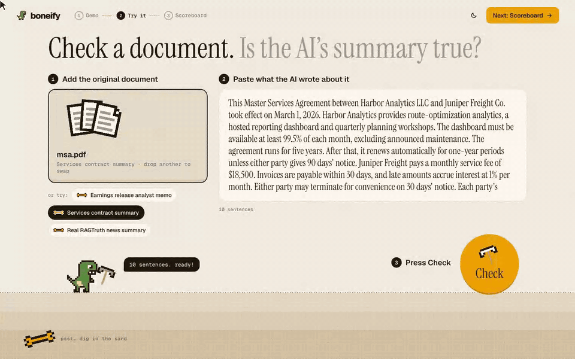
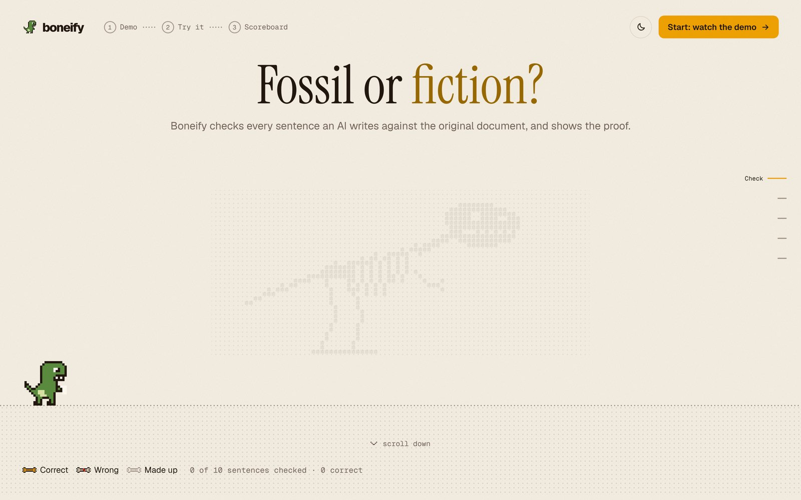
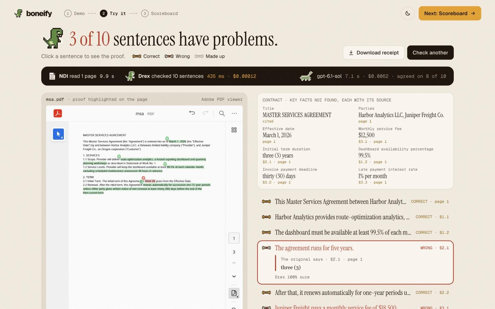
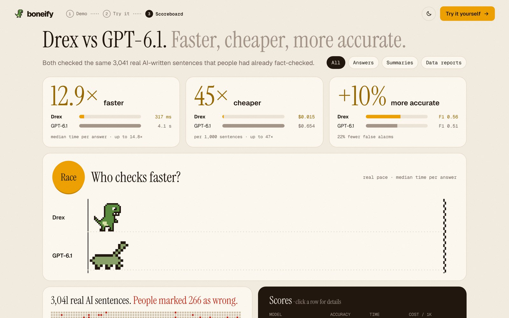

<div align="center">


# Boneify

**Fossil or fiction?** Boneify checks every sentence an AI writes against the original document, and shows you the proof on the page.

🥇 **1st place, Adobe track** · 🥈 **2nd place overall** · Drexathon 2026

[Live app](https://boneify.vercel.app) · [Slides](https://boneify-slides.vercel.app) · [Drexathon entry](https://github.com/nace-ai/intern/pull/39)

<br>



</div>

## What it does

Add the original document, paste what an AI wrote about it and press **Check**. Every sentence comes back **Correct**, **Wrong** or **Made up**, with a receipt: the page, the clause and the quote, boxed in the real PDF.

| | |
|---|---|
| **Read** | NDI (Nace Document Intelligence) reads the original, whether it's a PDF, Word file or scan, and pulls out the key facts with citations. |
| **Check** | Drex checks every sentence at once and says how sure it is. Anything under 60% is flagged for a person to review. |
| **Prove** | The Adobe PDF Embed API opens the real PDF with a box on each clause: green for correct, red for wrong. Click a sentence to jump to its box. |
| **Fix** | Intern rewrites only the flagged sentences from their receipts, then Boneify checks the rewrite again. |

## Results

Drex vs GPT-6.1 Sol on 450 RAGTruth test answers (3,041 sentences labelled by people), from `GET /api/benchmark`:

| | Sentence F1 | Median time per answer | Cost per 1,000 sentences | False alarms |
|---|:---:|:---:|:---:|:---:|
| **Drex Max v1.1** | **0.56** | **0.32 s** | **$0.015** | **354** |
| GPT-6.1 Sol | 0.51 | 4.08 s | $0.65 | 456 |

**12.9× faster, 45× cheaper and 10% more accurate**, and Drex comes out ahead on all three task types (answers, summaries and data reports).

## Screenshots

| Home | The receipt | Scoreboard |
|:---:|:---:|:---:|
|  |  |  |

## Run it locally

```bash
git clone https://github.com/nick-devvv/boneify
cd boneify
npm install
cp .env.example .env.local   # keys stay here, never in git
npm run dev                  # http://localhost:3000
```

With no keys it runs offline, using the built-in reader and simple rules. To use the real engines, set these in `.env.local`:

- **Drex and NDI:** `DECIDER=drex`, `PERCEIVER=ndi`, `NACE_BASE_URL`, `NACE_API_KEY`
- **The comparison model:** `LLM_API_KEY`, `LLM_BASE_URL`, `LLM_MODEL`, `LLM_LABEL` (any OpenAI-compatible API)

The Adobe viewer only loads on the live site's domain. Locally, the proof shows on a page Boneify draws itself.

`npm test` runs the test suite, and `npm run bench` re-runs the benchmark. The API is documented in [`docs/MVP_SPEC.md`](docs/MVP_SPEC.md).

## Built with

[Nace Drex](https://nace.ai) · NDI · [Intern](https://github.com/nace-ai/intern) · Adobe PDF Embed API · DeepInfra · Next.js · Vercel

## Team

[Nick](https://github.com/nick-devvv) (frontend and design) and [Anish Nallapu](https://github.com/anishnallapu) (backend and benchmark).

<sub>The companies in the sample contract are fictional.</sub>
