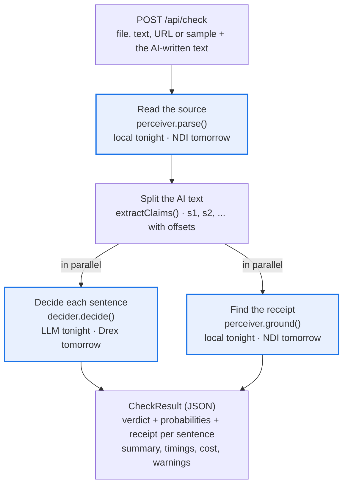

# boneify — MVP Spec (Drexathon)

Last updated: Nov 13, 2026

## What boneify is

boneify checks AI-written text against the document it came from, and gives every sentence a verdict plus a receipt. You upload the original (say, a contract) and paste the AI-written summary. In a few seconds each sentence turns green (backed up), red (contradicted) or yellow (not in the source, so probably made up), and links to the exact line in the original.

- **Pitch:** "Spell-check for AI lies. Every AI claim gets a receipt."
- **Track:** 1, Apex Predator (Drex vs. the Giants), which is judged on measured results.
- **What we prove on stage:** Drex vs. a frontier LLM on the same test, graded with a human answer key. We show accuracy, speed and cost side by side.
- **The answer key:** RAGTruth, a public dataset of about 18,000 AI-written answers where people marked every wrong or made-up phrase.
- **Both Nace tools:** NDI reads the file and finds the receipt, and Drex makes the call. Using NDI earns the bonus points.
- **Why the judges care:** Nace sells to professional services firms, and AI making things up in client work is those firms' biggest fear.

## Scope: tonight vs tomorrow

This spec covers the backend only, and Anish builds all of it. Tonight it runs on stand-ins, because the Nace API keys only arrive at the event. Tomorrow's switch is a settings change, not a code change.

| Backend part | Tonight (stand-in) | Tomorrow (real) |
| --- | --- | --- |
| Decider: makes the green / red / yellow call | A frontier LLM through any OpenAI-compatible API, plus an offline "simple rules" version. The real Drex code runs against the mock Nace server | Drex, `POST /v1/systemone` |
| Perceiver: reads the file and finds the receipt | Built-in PDF / text reader plus word matching. The real NDI code runs against the mock Nace server | NDI: upload, `parse`, then `ground` |
| API routes | Fully working | Unchanged |
| Benchmark script and results files | LLM baseline and simple-rules runs on RAGTruth | Add the Drex run |
| Sample data and fixtures | Committed | Unchanged |

- **The switch is two settings:** `DECIDER=llm` becomes `DECIDER=drex`, and `PERCEIVER=local` becomes `PERCEIVER=ndi`.
- **The API shapes in this spec are the contract.** Whatever calls the API later only reads them, so they must not change between tonight and tomorrow.
- **Out of scope here:** screens, styling and slides.

## Plug-in design: Drex and NDI work the minute the keys arrive

The Drex and NDI code gets written and run tonight against a fake Nace server that answers in exactly the documented formats. Tomorrow's plug-in is two values: the server address and the real key. Nothing is left as a TODO.

### Four rules

1. **Only two files talk to Nace:** `lib/decide/drex.ts` and `lib/perceive/ndi.ts`. Everything else talks to the `Decider` / `Perceiver` interfaces, so nothing else can break when the real API shows up.
2. **Both files are finished tonight,** written against the request and response formats in Engines, which come straight from Nace's docs.
3. **A mock Nace server runs them end to end tonight** (`scripts/mock-nace.ts`, details below). The whole API works with `DECIDER=drex` and `PERCEIVER=ndi`, before any key exists.
4. **The same contract tests run against the mock and the real API.** Tomorrow, `npm run test:live` checks the real responses' shapes in about a minute, so any difference from the docs shows up before the benchmark, not on stage.

### The mock Nace server (`npm run mock-nace`, port 4010)

It's a plain Node HTTP server with the same paths, auth rule, limits and response shapes as the real API. Its answers come from the offline engines, so it proves the plumbing, not the accuracy.

| Endpoint (same path as Nace) | What the mock does |
| --- | --- |
| `POST /v1/systemone` | Rejects a missing or non-`nace_sk_` key with 401. Validates like the real API: 422 if `state` is missing, if there are 0 or more than 512 questions, or if a `choice` question has no `criteria`. Answers each choice question over *its own* criteria labels, and returns `model`, `answers{id: {choice, confidence, probabilities}}`, `usage.input_tokens` (characters ÷ 4), `evaluation_time_ms`, `request_id`. |
| `POST /v1/documents/upload-grants` | Returns `workspace_id`, `token`, `expires_at`, and an `upload_url` pointing back to the mock. |
| `POST <upload_url>` | Requires `X-Upload-Token` and a `metadata` part with `path`. Keeps the file in memory, returns a job whose `result.file` has `workspace_id` and `file_id`. |
| `POST /v1/documents/parse` | Reads the stored file with the built-in reader. Returns `result.document` with `text`, `markdown`, `page_count` and `blocks[]` that each carry `location: {kind: "page_region", page}`. |
| `POST /v1/documents/ground` | 422 for 0 or more than 30 targets. Uses built-in matching, and returns `result.targets[]` with `id`, `status`, and `matches[]` (`rank`, `matched_text`, `match_method`, `confidence`, `location`). |
| `GET /v1/documents/jobs/:id` | Every job answers `running` on the first poll and `succeeded` on the next, so the polling code really runs. |

- **Failure drills:** `MOCK_FAIL=401` (or 402, 422, 429, 529) makes every call fail that way. The header `X-Mock-Fail: 529` does it for one call. `MOCK_LATENCY_MS=3000` simulates a slow day. These prove the readable errors, the retries and the NDI fallback.
- **Mock numbers never reach the scoreboard.** `npm run bench` refuses to save a Drex run while `NACE_BASE_URL` points at `localhost`, unless you pass `--allow-mock`. Mock files are named `*-mock.json`, and `/api/benchmark` hides them.

### Settings: tonight (mock) vs. tomorrow (real)

```bash
# Tonight: real Drex + NDI code, fake server
DECIDER=drex
PERCEIVER=ndi
NACE_BASE_URL=http://localhost:4010
NACE_API_KEY=nace_sk_mock_000000000000000000000000000000000000000

# Tomorrow: change these two lines, nothing else
NACE_BASE_URL=https://console.nace.ai
NACE_API_KEY=nace_sk_...your real key...
```

**Tomorrow, in order:** paste the two values, run `npm run test:live`, run `npm run smoke -- drex` and `npm run smoke -- ndi`, run `npm run bench -- --decider drex --name drex`, then set the same two values in Vercel and redeploy.

## How it works

Every check runs the same four steps, and only the shaded boxes change between tonight and tomorrow.



1. **Read the source once** with `perceiver.parse()`, getting text plus page offsets. With NDI, the parse job id is kept so grounding reuses it and isn't paid for twice.
2. **Split the AI text** into sentences with exact character offsets (`extractClaims()`, skipping fragments under 3 words).
3. **At the same time:** `decider.decide()` gives each sentence a probability for all three verdicts, and `perceiver.ground()` finds each sentence's receipt.
4. **Combine into a `CheckResult`.** The verdict is the highest probability. `needsReview` is set when confidence is below `REVIEW_THRESHOLD`. `trustScore` is the share of sentences supported, and timings, cost and warnings are attached.

The benchmark reuses steps 2 and 3, the decision only. Receipts aren't scored.

## Tech stack and folder layout

The backend is a Next.js app with API routes only, written in TypeScript and deployed on Vercel. A front end can be added to `app/` later without touching any of it.

- **Framework:** Next.js 16 App Router route handlers, Node runtime (not Edge), Node 20+ (22 recommended).
- **No database.** Benchmark results are JSON files in `data/results/`, committed and bundled into the deployment.
- **Libraries:** `unpdf` (PDF text that works in serverless), `zod` (request validation), `tsx` (runs scripts), `vitest` (tests).
- **No vendor SDKs.** Drex, NDI and the LLM are called with plain `fetch`, so every request is visible and easy to debug.

```text
boneify/
├── app/api/
│   ├── health/route.ts            GET   which engines are ready
│   ├── check/route.ts             POST  check a document (the main feature)
│   ├── samples/route.ts           GET   list demo samples
│   ├── samples/[id]/route.ts      GET   one demo sample
│   ├── benchmark/route.ts         GET   scoreboard summaries
│   └── benchmark/[run]/route.ts   GET   one run, with per-example detail
├── lib/
│   ├── types.ts                   shared types (see Data shapes)
│   ├── config.ts                  reads environment variables
│   ├── claims.ts                  AI text -> sentences to check
│   ├── pipeline.ts                checkDocument(): the whole flow
│   ├── http.ts                    fetch with timeout, retries, readable errors
│   ├── text/sentences.ts          sentence splitter that keeps character offsets
│   ├── text/similarity.ts         BM25 search, numbers, names (offline engines)
│   ├── decide/
│   │   ├── index.ts               getDecider(id)     <- swap point 1
│   │   ├── instructions.ts        label wording shared by the LLM and Drex
│   │   ├── local.ts               offline simple rules
│   │   ├── llm.ts                 frontier LLM stand-in
│   │   └── drex.ts                Drex
│   ├── perceive/
│   │   ├── index.ts               getPerceiver(id)   <- swap point 2
│   │   ├── local.ts               built-in reader + word matching
│   │   └── ndi.ts                 NDI upload -> parse -> ground
│   └── benchmark/
│       ├── dataset.ts             RAGTruth -> per-sentence labels
│       └── metrics.ts             precision, recall, F1, latency, cost
├── scripts/
│   ├── prepare-ragtruth.ts        builds data/ragtruth/sample.jsonl
│   ├── benchmark.ts               runs one engine over the sample -> data/results/
│   ├── check.ts                   checks a file from the terminal
│   ├── mock-nace.ts               fake Drex + NDI server for tonight
│   └── smoke.ts                   one tiny live call to Drex / NDI / the LLM
├── data/
│   ├── ragtruth/sample.jsonl      450 test examples (committed)
│   ├── results/*.json             benchmark runs (committed)
│   ├── samples/                   demo documents (.json + .pdf)
│   └── fixtures/                  saved example API responses
├── tests/*.test.ts
├── .env.example
├── next.config.mjs
└── package.json
```

| Command | What it does |
| --- | --- |
| `npm run dev` | Runs the API at `http://localhost:3000` |
| `npm test` | Runs all tests (no keys needed) |
| `npm run build` | Production build, the same step Vercel runs |
| `npm run prepare-data` | Rebuilds the RAGTruth sample from the GitHub dataset |
| `npm run bench -- --decider llm` | Runs the benchmark with one decider and saves a results file |
| `npm run check -- --source contract.pdf --text summary.txt` | Checks a document from the terminal |
| `npm run smoke -- drex` | Makes one tiny live call to Drex (or `ndi`, `llm`) to prove the key works |

## Data shapes

Every part of the backend shares the types in `lib/types.ts`. The two swap points are the `Decider` and `Perceiver` interfaces: every engine implements one, and nothing else depends on which engine is running.

- **Three verdicts:** `supported` (green), `contradicted` (red), `not_in_source` (yellow).
- **Probabilities always cover all three verdicts and add up to 1.** The verdict is whichever is highest, and `confidence` is that probability.
- **Offsets are character positions,** so any sentence or receipt can be highlighted exactly.

```ts
export type Verdict = "supported" | "contradicted" | "not_in_source";
export type Probabilities = Record<Verdict, number>; // sums to 1

// One sentence of the AI-written text. Offsets point into that text.
export interface Claim { id: string; index: number; text: string; start: number; end: number } // id: "s1", "s2", ...

// The source document after reading. Page offsets point into `text`.
export interface SourcePage { page: number; start: number; end: number } // page is 1-based
export interface SourceDocument {
  name: string;
  format: string;            // "pdf" | "text" | "json" | "markdown" | "html" | NDI lane
  text: string;
  pages: SourcePage[];
  parsedBy: string;          // "local" | "ndi"
  ndi?: { parseJobId?: string; workspaceId?: string; fileId?: string }; // lets ground reuse the parse
}

export type SourceInput =
  | { kind: "text"; text: string; name?: string }
  | { kind: "file"; bytes: Uint8Array; name: string; mimeType?: string }
  | { kind: "url"; url: string; name?: string };

// Where the evidence for a claim lives.
export interface Receipt {
  status: "found" | "not_found";
  page: number | null;
  quote: string | null;      // the matching source text
  charStart: number | null;  // offsets into SourceDocument.text, when known
  charEnd: number | null;
  method: string;            // "lexical" | "exact" | "normalized" | "semantic"
  score: number | null;      // 0..1 when known
  region?: unknown;          // raw NDI location (page polygons etc.)
}

export interface DecideContext { task?: string; question?: string } // how the AI text was produced
export interface Decision { claimId: string; verdict: Verdict; probabilities: Probabilities; confidence: number }
export interface Usage { requests: number; inputTokens: number; outputTokens: number; costUsd: number }
export interface DecideResult { decisions: Decision[]; usage: Usage; latencyMs: number; model: string }
export interface GroundResult { receipts: Record<string, Receipt>; latencyMs: number; usage?: Usage; warnings?: string[] }

// Swap point 1: who makes the call ("local" | "llm" | "drex")
export interface Decider {
  id: string; label: string; model: string;
  decide(doc: SourceDocument, claims: Claim[], ctx?: DecideContext): Promise<DecideResult>;
}

// Swap point 2: who reads the file and finds receipts ("local" | "ndi")
export interface Perceiver {
  id: string; label: string;
  parse(input: SourceInput): Promise<SourceDocument>;
  ground(doc: SourceDocument, claims: Claim[]): Promise<GroundResult>;
}

// What POST /api/check returns.
export interface CheckedClaim extends Claim {
  verdict: Verdict; probabilities: Probabilities; confidence: number;
  needsReview: boolean;      // confidence below REVIEW_THRESHOLD
  receipt: Receipt;
}
export interface CheckResult {
  id: string; createdAt: string;
  engines: { decider: string; deciderModel: string; perceiver: string };
  source: { name: string; format: string; pages: number; characters: number };
  claims: CheckedClaim[];
  summary: { total: number; supported: number; contradicted: number; not_in_source: number;
             needsReview: number; trustScore: number }; // trustScore = % of sentences supported, 0..100
  timings: { parseMs: number; decideMs: number; groundMs: number; totalMs: number };
  usage: { decide: Usage; ground?: Usage };
  warnings: string[];        // e.g. "NDI could not locate 2 sentences; used the built-in matcher"
}
```

## API contract

The API has six endpoints, all under `/api`, all JSON (except a sample's PDF). `POST /api/check` is the product, and the rest feed the demo and the scoreboard. Every route sends CORS headers (origin from `ALLOWED_ORIGIN`, default `*`) and answers `OPTIONS`, so a front end hosted elsewhere can call it.

| Method | Path | Purpose |
| --- | --- | --- |
| GET | `/api/health` | Which engines are ready, plus the defaults |
| POST | `/api/check` | Check AI text against a source document |
| GET | `/api/samples` | List the demo samples |
| GET | `/api/samples/:id` | One demo sample (`?format=pdf` returns the original PDF) |
| GET | `/api/benchmark` | One summary row per benchmark run, for the scoreboard |
| GET | `/api/benchmark/:run` | One run in full, with per-example detail and filters |

### GET /api/health

This endpoint never reveals keys. `ready` is true when the key that engine needs is set.

```json
{
  "ok": true,
  "version": "0.1.0",
  "defaults": { "decider": "llm", "perceiver": "local", "reviewThreshold": 0.6 },
  "deciders": [
    { "id": "local", "label": "Simple rules (offline)", "ready": true },
    { "id": "llm", "label": "Frontier LLM", "model": "<LLM_MODEL>", "ready": true },
    { "id": "drex", "label": "Drex", "model": "drex-latest", "ready": false, "note": "Set NACE_API_KEY to enable." }
  ],
  "perceivers": [
    { "id": "local", "label": "Built-in reader (offline)", "ready": true },
    { "id": "ndi", "label": "NDI (Nace Document Intelligence)", "ready": false, "note": "Set NACE_API_KEY to enable." }
  ]
}
```

### POST /api/check

Send exactly one source (a file, `sourceText`, `sourceUrl` or `sampleId`) plus `aiText`. It accepts two body types:

- **`multipart/form-data`** (file upload): `file`, `aiText`, and optionally `task`, `question`, `decider`, `perceiver`, `reviewThreshold`.
- **`application/json`** (everything else):

```json
{
  "sourceText": "MASTER SERVICES AGREEMENT ... The initial term is three (3) years ...",
  "sourceName": "msa.txt",
  "aiText": "The agreement runs for five years. Either party may cancel with 30 days' notice.",
  "context": { "task": "Summarize the contract for a partner" },
  "decider": "drex",
  "perceiver": "ndi",
  "reviewThreshold": 0.6
}
```

`decider` and `perceiver` are optional overrides. Leave them out to use the `DECIDER` and `PERCEIVER` settings. `sampleId` loads a demo sample's source, AI text and context in one go, as in `{ "sampleId": "msa-summary" }`.

A 200 response is a `CheckResult` (see Data shapes). Trimmed example:

```json
{
  "id": "7c1e...",
  "createdAt": "2026-11-14T18:02:11.000Z",
  "engines": { "decider": "drex", "deciderModel": "drex-max-v1.1", "perceiver": "ndi" },
  "source": { "name": "msa.pdf", "format": "pdf", "pages": 4, "characters": 18234 },
  "claims": [
    {
      "id": "s1", "index": 0, "text": "The agreement runs for five years.", "start": 0, "end": 34,
      "verdict": "contradicted",
      "probabilities": { "supported": 0.03, "contradicted": 0.91, "not_in_source": 0.06 },
      "confidence": 0.91, "needsReview": false,
      "receipt": { "status": "found", "page": 1, "quote": "The initial term is three (3) years",
                   "charStart": 412, "charEnd": 447, "method": "semantic", "score": 0.88 }
    },
    {
      "id": "s2", "index": 1, "text": "Either party may cancel with 30 days' notice.", "start": 35, "end": 80,
      "verdict": "not_in_source",
      "probabilities": { "supported": 0.12, "contradicted": 0.21, "not_in_source": 0.67 },
      "confidence": 0.67, "needsReview": false,
      "receipt": { "status": "not_found", "page": null, "quote": null, "charStart": null, "charEnd": null, "method": "semantic", "score": null }
    }
  ],
  "summary": { "total": 2, "supported": 0, "contradicted": 1, "not_in_source": 1, "needsReview": 0, "trustScore": 0 },
  "timings": { "parseMs": 2100, "decideMs": 240, "groundMs": 1300, "totalMs": 3420 },
  "usage": { "decide": { "requests": 1, "inputTokens": 5120, "outputTokens": 0, "costUsd": 0.0003 },
             "ground": { "requests": 1, "inputTokens": 0, "outputTokens": 0, "costUsd": 0 } },
  "warnings": []
}
```

The numbers in this example are illustrative only, not measured.

### GET /api/samples and /api/samples/:id

```json
// GET /api/samples
{ "samples": [ { "id": "msa-summary", "title": "Services contract summary", "description": "AI summary of a 4-page MSA with 3 planted errors", "sourceName": "msa.pdf", "hasPdf": true } ] }

// GET /api/samples/msa-summary
{ "id": "msa-summary", "title": "...", "sourceName": "msa.pdf", "sourceText": "...", "aiText": "...",
  "context": { "task": "Summarize the contract for a partner" },
  "plantedErrors": [ { "sentence": "The agreement runs for five years.", "expected": "contradicted", "why": "Contract says 3 years" } ],
  "pdfUrl": "/api/samples/msa-summary?format=pdf" }
```

### GET /api/benchmark and /api/benchmark/:run

`/api/benchmark` returns one summary per file in `data/results/`. `/api/benchmark/:run` returns that file's full metrics plus a page of examples. Filters: `task` (`QA` | `Summary` | `Data2txt`), `onlyMistakes=true`, `offset` (default 0), `limit` (default 25, max 100).

```json
// GET /api/benchmark
{ "runs": [ {
  "run": "llm-gpt", "label": "Frontier LLM", "decider": "llm", "model": "<LLM_MODEL>", "createdAt": "...",
  "dataset": { "name": "RAGTruth", "split": "test", "examples": 450, "sentences": 2400 },
  "headline": { "sentenceF1": 0.0, "sentencePrecision": 0.0, "sentenceRecall": 0.0, "responseF1": 0.0,
                "threeWayAccuracy": 0.0, "p50LatencyMs": 0, "meanLatencyMs": 0,
                "costPerThousandSentencesUsd": 0.0, "totalCostUsd": 0.0 }
} ] }

// GET /api/benchmark/llm-gpt?onlyMistakes=true&limit=2
{ "run": "llm-gpt", "label": "...", "metrics": { ...full Metrics (Benchmark section)... },
  "total": 131, "offset": 0, "limit": 2,
  "examples": [ { "id": "14031", "task": "Summary", "writerModel": "llama-2-7b-chat", "latencyMs": 3120,
                  "claims": [ { "id": "s4", "text": "...", "gold": "contradicted", "pred": "supported", "confidence": 0.71,
                                "probabilities": { "supported": 0.71, "contradicted": 0.2, "not_in_source": 0.09 } } ] } ] }
```

### Errors

Every error has the same shape: `{ "error": { "code": "missing_ai_text", "message": "Paste the AI-written text to check." } }`.

| Status | When | Example code |
| --- | --- | --- |
| 400 | Bad or missing input | `missing_ai_text`, `missing_source`, `two_sources`, `no_sentences`, `unknown_engine` |
| 404 | Unknown sample or run | `sample_not_found`, `run_not_found` |
| 413 | File over 4 MB or AI text over 20,000 characters | `too_large` |
| 422 | The file couldn't be read | `unreadable_file`, `unsupported_file_type`, `empty_source` |
| 502 | Drex, NDI or the LLM failed | `provider_error` (message names the provider and says why, e.g. "Drex: the API key is missing or wrong") |
| 500 | Anything unexpected | `internal_error` |

## Front-end numbers: every figure on screen comes from the API

Track 1 is judged on measured results and the size of the improvement, so the front end never computes or hard-codes a statistic. It only formats what the API returns, and shows a dash for anything the API hasn't returned. Four small additions below make that possible.

| Where on screen | What it shows | API source |
| --- | --- | --- |
| Landing hero, live demo | Each sentence's verdict and page, the running counts | A recorded `POST /api/check` run of `msa-summary`, saved as `data/fixtures/check-response.json` (`claims[].verdict`, `claims[].receipt`, `summary`) |
| App, input | Sample list | `GET /api/samples` |
| App, input | Engines ready | `GET /api/health` |
| App, input | Sentence count before digging | `POST /api/split` (new) |
| App, results | "3 of 7 don't hold up" | `summary.contradicted + summary.not_in_source`, out of `summary.total` |
| App, results | Needs a look | `summary.needsReview` |
| App, results | Time | `timings.totalMs` (and `decideMs`) |
| App, results | Cost | `usage.decide.costUsd + usage.ground.costUsd` |
| App, results | "Drex 91% sure" and the odds bar | `claims[].confidence`, `claims[].probabilities` |
| App, results | Page and clause of each receipt | `receipt.page`, `receipt.section` (new) |
| App, results | Race strip: Drex vs the LLM on this same document (time, cost, agreement) | `comparison` (new, when the request sends `compare`) |
| Scoreboard | F1, precision, recall, time per document (p50), $ per 1,000 sentences | `GET /api/benchmark` → `runs[].headline` |
| Scoreboard | Improvement banner: times faster, times cheaper, F1 change vs the LLM | `GET /api/benchmark` → `improvement` (new) |
| Scoreboard | Test facts: answers, sentences, marked wrong, contradicted vs made up, writer models | `GET /api/benchmark` → `dataset` (new) |
| Scoreboard | Task filter (All / QA / Summary / Data2txt) | `GET /api/benchmark?task=…` (new filter) |

### Addition 1: `GET /api/benchmark` gains `dataset`, `improvement` and `?task=`

```json
{
  "dataset": {
    "name": "RAGTruth", "split": "test", "seed": 2026, "examples": 450, "sentences": 3041,
    "wrong": { "total": 266, "contradicted": 123, "notInSource": 143 },
    "writerModels": 6,
    "byTask": {
      "QA": { "examples": 150, "sentences": 926, "wrong": 44 },
      "Summary": { "examples": 150, "sentences": 812, "wrong": 46 },
      "Data2txt": { "examples": 150, "sentences": 1303, "wrong": 176 }
    }
  },
  "runs": [ "...as before..." ],
  "improvement": {
    "drex": "drex", "baseline": "llm-gpt",
    "speedup": 0.0, "costRatio": 0.0,
    "f1Delta": 0.0, "precisionDelta": 0.0, "recallDelta": 0.0
  }
}
```

- **`dataset`** is computed from `data/ragtruth/sample.jsonl` with the same `goldClaims()` the benchmark uses, so it always matches the runs. For seed 2026 the values are exactly the ones shown above, so use them as a test.
- **`improvement`** compares the Drex run (`DREX_RUN`, default `drex`) with the baseline (`BASELINE_RUN`, default the first `llm-*` run):
  - `speedup` = baseline p50 ÷ Drex p50
  - `costRatio` = Drex cost per 1,000 sentences ÷ baseline cost per 1,000
  - the deltas = Drex minus baseline
  - It's `null` until both runs exist. Never estimated.
- **`?task=QA|Summary|Data2txt`** returns the same shape for one task: each run's headline and the improvement are computed from `metrics.byTask`. So `byTask` must carry latency and cost per task as well as the scores.

### Addition 2: `POST /api/check` can race a second decider

Send `"compare": "llm"` (JSON) or a `compare=llm` form field. The server runs that decider on the same parsed document and the same claims, in parallel with the main one, and adds:

```json
"comparison": {
  "decider": "llm", "model": "<LLM_MODEL>",
  "decideMs": 0, "costUsd": 0,
  "agreement": { "same": 0, "total": 7 },
  "verdicts": { "s1": "supported", "s2": "contradicted" }
}
```

The main result still comes from `DECIDER`. If the comparison decider fails, `comparison` is `null` and a warning is added, and the check itself still succeeds. This is the live, on-stage version of the benchmark: same memo, two deciders, real time and cost side by side.

### Addition 3: `receipt.section`

This is the clause number at the start of the matched source paragraph (`2.1`, `§3.2`, `Article 4`), found with a regex, or `null` when there isn't one. It lets the UI say "p.1 §2.1" without guessing.

### Addition 4: `POST /api/split`

`{ "text": "..." }` returns `{ "count": 7, "claims": [{ "id": "s1", "text": "...", "start": 0, "end": 79 }] }`, using the same `extractClaims()` as the check, so the count before digging matches the count after.

**Done checklist additions:** `dataset` matches the numbers above for seed 2026. `improvement` is `null` with one run and filled with two. `compare` works with `DECIDER=drex` against the mock and with `DECIDER=local` offline. `receipt.section` is set on the `msa-summary` sample.

## Engines

There are five engines behind the two swap points: three deciders (`local`, `llm`, `drex`) and two perceivers (`local`, `ndi`). The LLM and Drex get the same source text, the same three labels and the same label definitions, so the benchmark is a fair fight.

### Shared label wording (`lib/decide/instructions.ts`)

| Label | Definition sent to both the LLM and Drex |
| --- | --- |
| `supported` | The source states or clearly implies everything in this sentence. |
| `contradicted` | The sentence conflicts with the source: a wrong number, date, name, place, amount, or fact. |
| `not_in_source` | The source does not mention some of this information; it was added, assumed, or made up. |

The per-sentence instruction is: *Check this sentence from an AI-written text against the source document in the state. Judge only by the source; outside knowledge does not count as support. Sentence: "..."*

### Decider `local`: simple rules, offline

This engine needs no key and costs nothing. It keeps the product working with zero setup, gives the scoreboard a baseline row, and makes the tests run offline.

1. Index the source as sentences (or as `key: value` lines when the source is JSON) with BM25.
2. For each claim, measure word coverage against the top 2 matching source sentences and against the whole document.
3. A number in the claim that's missing from the source means `contradicted` if the best-matching sentence has a different number, otherwise `not_in_source`.
4. Names missing from the source push toward `not_in_source`. A negation mismatch ("not" on one side only) pushes toward `contradicted`.
5. A sigmoid on coverage gives P(supported), and the remainder is split between the other two by the signals above.

### Decider `llm`: tonight's "Giant"

- **Call:** `POST {LLM_BASE_URL}/chat/completions` with `Authorization: Bearer {LLM_API_KEY}`, `model: LLM_MODEL`, `temperature: 0` (set `LLM_TEMPERATURE=none` for models that reject it) and `response_format: {"type":"json_object"}`.
- **Any OpenAI-compatible host works.** With OpenRouter (`LLM_BASE_URL=https://openrouter.ai/api/v1`), one key can run several giants: change `LLM_MODEL`, rerun the benchmark, get another scoreboard row.
- **Batching:** 40 sentences per call. The source document goes in every call.
- **System prompt:** the three definitions above, "judge only by the source", then: *Respond with JSON only, in exactly this shape: `{"s1": {"supported": 0.0, "contradicted": 0.0, "not_in_source": 0.0}, ...}`. Each sentence's three numbers must add up to 1. Include every sentence id you were given.*
- **User prompt:** `SOURCE DOCUMENT: <<< ... >>>`, then `CONTEXT:` (task and question, if any), then `SENTENCES TO CHECK:` as `s1: ...` lines.
- **Parsing:** strip code fences, accept `{"s1":...}`, `{"verdicts":...}` or `{"results":[{"id":...}]}`, and normalise to sum to 1. A missing sentence gets a uniform 1/3 each, which shows up as low confidence.
- **Cost:** use `usage.cost` when the host reports it (OpenRouter does). Otherwise `prompt_tokens × LLM_PRICE_INPUT_PER_MTOK + completion_tokens × LLM_PRICE_OUTPUT_PER_MTOK`, divided by 1,000,000.

### Decider `drex`: tomorrow

Source: [Drex API reference](https://console.nace.ai/docs/drex/api-reference/systemone), [Questions guide](https://console.nace.ai/docs/drex/guides/questions), [Quickstart](https://console.nace.ai/docs/drex/quickstart).

- **Call:** `POST https://console.nace.ai/v1/systemone` with `Authorization: Bearer {NACE_API_KEY}` (keys start with `nace_sk_`).
- **Body:** `model` (optional; `drex-latest` currently points to `drex-max-v1.1`, and pinned ids include `drex-v2.0`, `drex-max-v1.1`, `drex-max-finance`), `state` (any JSON, required), `questions` (an object keyed by question id, 1 to 512 entries).
- **Question type:** `choice`, with `instructions` and `criteria` (an object of label to description). The labels come back as the keys of `probabilities`.
- **Response:** `answers[id] = { choice, confidence, probabilities }`, plus `model`, `usage.input_tokens`, `usage.output_tokens`, `evaluation_time_ms`, `request_id`.
- **Limits:** body up to 4 MiB in total. For `drex-v2.0`, state is capped at 131,072 tokens; max-tier models allow 262,144 tokens per request. State must be text: PDFs, images and audio inside `state` get a 422. A request that takes longer than 55 seconds returns 529.
- **Errors:** 401 bad or missing key, 402 out of credit, 422 invalid body or too many tokens, 429 / 529 rate-limited or overloaded (retry with backoff). Only a 200 is billed, and only input tokens count.
- **Batching:** one request per document, up to `DREX_BATCH_SIZE` questions (default 256). A typical summary of 10 to 40 sentences is a single call.
- **Reading answers defensively:** use `probabilities` when present. Otherwise build them from `choice` + `confidence`. If a yes/no `noul` answer ever comes back, map it to supported vs. not\_in\_source.

```json
{
  "model": "drex-latest",
  "state": {
    "source_document": "MASTER SERVICES AGREEMENT ... The initial term is three (3) years ...",
    "context": "Writing task: Summarize the contract for a partner."
  },
  "questions": {
    "s1": {
      "type": "choice",
      "instructions": "Check this sentence from an AI-written text against the source document in the state. Judge only by the source; outside knowledge does not count as support. Sentence: \"The agreement runs for five years.\"",
      "criteria": {
        "supported": "The source states or clearly implies everything in this sentence.",
        "contradicted": "The sentence conflicts with the source: a wrong number, date, name, place, amount, or fact.",
        "not_in_source": "The source does not mention some of this information; it was added, assumed, or made up."
      }
    }
  }
}
```

### Perceiver `local`: built-in reader, offline

- **Reads:** PDF (text per page through `unpdf`, keeping page offsets), TXT, MD, CSV, TSV, JSON and HTML (tags stripped). Anything else returns `422 unsupported_file_type` with the hint "switch PERCEIVER=ndi". A PDF with no text layer (a scan) returns `422 empty_source` with the same hint.
- **Receipts:** the best BM25 source sentence for each claim. It counts as `found` when at least 30% of the claim's words appear in it. Page numbers come from the page offsets, and the method is `lexical`.

### Perceiver `ndi`: tomorrow

Source: [Uploads](https://console.nace.ai/docs/perception/uploads), [Parse](https://console.nace.ai/docs/perception/parse), [Ground](https://console.nace.ai/docs/perception/ground), [Jobs](https://console.nace.ai/docs/perception/jobs). Base URL `https://console.nace.ai/v1`, same Bearer key and same credit as Drex.

1. **Upload** (skipped for URL sources, which use `{"type":"url","url":...,"file_name":...}`):
   - `POST /documents/upload-grants` with `{ "path": "receipts/<timestamp>-<random>-<name>", "ttl_seconds": 600, "total_size_bytes": N }` returns `workspace_id`, `upload_url`, `token`, `expires_at`, `max_bytes`. A grant works once.
   - Multipart `POST` to `upload_url` with header `X-Upload-Token: <token>` and two parts: `file`, and `metadata` = `{"path":"..."}` (`application/json`). It returns a job. When it succeeds, `result.file` holds `workspace_id` and `file_id`.
   - Paths must be unique: the default `on_conflict: reject` fails a reused path with a different file. That's why the path has a timestamp and a random part.
2. **Parse, once:** `POST /documents/parse?wait_seconds=60` with `{ "source": {"type":"workspace_file","workspace_id":...,"file_id":...}, "output": {"formats":["text","markdown","blocks"]} }`.
   - The job envelope has `job_id`, `kind`, `status` (`queued` | `running` | `succeeded` | `failed` | `cancelled`), `result`, `error`, `cost` and `credits`.
   - If the job isn't final yet, poll `GET /documents/jobs/{job_id}` starting at 1 s and backing off to 10 s, giving up after 240 s. `wait_seconds` accepts 1 to 100.
   - The result is `result.document` with `text`, `markdown`, `page_count` and `blocks[]`. Each block has a `location` (`kind: page_region`, 1-based `page`). Build the page offsets by grouping block text by page.
3. **Ground, reusing the parse:** `POST /documents/ground?wait_seconds=60` with `{ "source": {"type":"parse_result","job_id":"<parse job id>"}, "targets": [{"id":"s1","text":"<sentence>","semantic":true}], "options": {"max_matches":1} }`. Send 1 to 30 targets per request, so loop for longer texts.
   - Each item in `result.targets[]` has `id`, `status` (`found` | `not_found` | `failed`) and `matches[]` (`rank`, `matched_text`, `match_method`, `confidence`, `location`, `cropped_image_url`).
   - Map the top match to a `Receipt`. `location.page` gives the page; `char_start` / `char_end` exist only for `text_span` locations.
   - Ground only *locates* text; it does not judge whether a claim is true. That's exactly why Drex makes the call.

**Fallbacks:** a target that fails gets a local receipt, plus a warning. If NDI fails completely, the whole ground step falls back to local and the check still returns. If NDI can't parse a text or file source, the built-in reader takes over, with a warning.

**To confirm on the first live call tomorrow** (run `npm run smoke -- ndi`):

- [ ] The field that holds block text. The code reads `text`, then `markdown`, then `content`.
- [ ] The shape of `cost` on a job (number or object).
- [ ] That `https://console.nace.ai` is the API host for your key. If not, set `NACE_BASE_URL`.
- [ ] The real price for `drex-latest`. Set `DREX_PRICE_PER_MTOK` (the default 0.06 is the published `drex-v2.0` price).

## Benchmark

The scoreboard comes from running each decider over the same 450 RAGTruth test answers (3,041 sentences, 266 of them marked wrong by humans) and grading against that human answer key. Headline numbers: sentence-level F1, cost per 1,000 sentences, and median time per document.

### The answer key: RAGTruth

- **Where:** [github.com/ParticleMedia/RAGTruth](https://github.com/ParticleMedia/RAGTruth), files `dataset/response.jsonl` and `dataset/source_info.jsonl`, MIT licence, so committing a sample is fine.
- **What's in it:** 17,790 AI-written answers from 6 models (GPT-4, GPT-3.5, Llama-2 7B/13B/70B, Mistral 7B). People marked every wrong or made-up span in them.
- **Three tasks:** `QA` (answer a question from 3 passages), `Summary` (summarise a news article), `Data2txt` (describe a business from Yelp JSON).
- **Span types:** Evident Baseless Info (6,237), Evident Conflict (5,324), Subtle Baseless Info (2,527), Subtle Conflict (201).
- **Split:** use `test` only (2,700 answers, 900 per task) and keep `quality == "good"`, which leaves 2,675.

### Our sample (`data/ragtruth/sample.jsonl`)

`scripts/prepare-ragtruth.ts` takes 150 answers per task with a seeded shuffle (seed 2026), so everyone gets the same 450 every time. Each line looks like this:

```json
{ "id": "14031", "sourceId": "9871", "task": "Summary", "writerModel": "llama-2-7b-chat",
  "question": null, "source": "<article / passages / pretty-printed JSON>", "response": "<AI answer>",
  "spans": [ { "start": 636, "end": 653, "type": "conflict", "labelType": "Evident Conflict",
               "implicitTrue": false, "dueToNull": false, "note": "Original: February 7 (1945) ..." } ] }
```

| Task | Answers | Sentences | Marked wrong | Avg source length |
| --- | --- | --- | --- | --- |
| QA | 150 | 926 | 44 | \~1,370 characters |
| Summary | 150 | 812 | 46 | \~3,210 characters |
| Data2txt | 150 | 1,303 | 176 | \~2,750 characters |
| **All** | **450** | **3,041** | **266** (123 contradicted, 143 not in source) | \~2,450 characters, max 9,918 |

Sentence counts are what `extractClaims()` produces (fragments under 3 words skipped), so they change if the splitter changes; the marked-wrong counts come from the human labels. `npm run prepare-data` prints them.

171 of the 450 answers contain at least one marked span. `--full` runs all 2,675 instead.

### Turning marked spans into sentence labels (`lib/benchmark/dataset.ts`)

1. Split the AI answer with the same `extractClaims()` the product uses. Fragments under 3 words are skipped.
2. A sentence overlapping a `Conflict` span gets `contradicted`. If it overlaps only `Baseless` spans, it gets `not_in_source`. Otherwise it's `supported`.
3. Every span type counts, `implicitTrue` included, matching the RAGTruth authors' own baseline code.
4. An answer counts as wrong (answer level) if it has any marked span at all.
5. Context for the decider: the task description, plus the question for `QA`. The source is the passages (QA), the article (Summary) or pretty-printed JSON (Data2txt).

### Scoring (`lib/benchmark/metrics.ts`)

"Positive" means the sentence or answer contains something wrong or made up. Only about 9% of sentences are positive, so plain accuracy is misleading: always answering "supported" scores 91%. F1 is the headline.

| Metric | Meaning |
| --- | --- |
| Sentence precision | Of the sentences flagged, the share that really were wrong |
| Sentence recall | Of the sentences that really were wrong, the share that got flagged |
| Sentence F1 | The balance of the two. **Headline accuracy number** |
| Three-way accuracy | Exact match on supported / contradicted / not\_in\_source |
| Answer-level P / R / F1 | The same, per answer (any sentence flagged) |
| Latency | Wall-clock time around `decide()` per document: mean, p50, p95 |
| Cost | Total dollars, and dollars per 1,000 sentences |
| By task | All of the above for QA, Summary and Data2txt separately |
| Abstain curve | At confidence thresholds 0.5 / 0.6 / 0.7 / 0.8 / 0.9 / 0.95: the share of sentences auto-decided, and the accuracy on those |

### The runner (`scripts/benchmark.ts`)

```text
npm run bench -- --decider llm  --name llm-gpt --label "GPT (frontier)"
npm run bench -- --decider local --name local
npm run bench -- --decider drex --name drex                 # tomorrow
optional: --limit 50  --task QA  --concurrency 4  --resume  --full
```

- It writes `data/results/<name>.json` and saves progress every 25 answers, so `--resume` continues after a crash or a rate limit.
- One answer failing (after retries) is recorded with its `error` and skipped. The run never dies on a single bad call.
- It prints a one-line summary at the end: F1, p50 latency, cost per 1,000 sentences.
- **Fair-fight rules:** same sample, same source text, same context, same label wording. The LLM runs at temperature 0. Latency only measures the decision call.

Results file shape (`/api/benchmark/:run` serves it):

```json
{ "run": "llm-gpt", "label": "GPT (frontier)", "decider": "llm", "model": "<LLM_MODEL>",
  "createdAt": "2026-11-13T23:10:00Z", "dataset": { "name": "RAGTruth", "split": "test", "examples": 450, "seed": 2026 },
  "settings": { "concurrency": 4, "batchSize": 40 },
  "metrics": { "examples": 450, "failedExamples": 0, "sentences": 3041, "wrongSentencesInKey": 266,
               "sentence": { "tp": 0, "fp": 0, "fn": 0, "tn": 0, "precision": 0, "recall": 0, "f1": 0, "accuracy": 0, "threeWayAccuracy": 0 },
               "response": { "...": "same fields" },
               "latency": { "meanMs": 0, "p50Ms": 0, "p95Ms": 0, "totalMs": 0 },
               "cost": { "totalUsd": 0, "perThousandSentencesUsd": 0, "requests": 0, "inputTokens": 0, "outputTokens": 0 },
               "byTask": { "QA": { "examples": 150, "sentence": {}, "response": {} } },
               "abstain": [ { "threshold": 0.9, "coverage": 0, "accuracy": 0 } ] },
  "examples": [ { "id": "14031", "task": "Summary", "writerModel": "llama-2-7b-chat", "goldHallucinated": true,
                  "latencyMs": 0, "usage": {}, "claims": [ { "id": "s1", "text": "...", "gold": "supported",
                  "pred": "supported", "confidence": 0.97, "probabilities": {} } ] } ] }
```

**Never fake a row.** Until the Drex run exists, the scoreboard shows only real runs. Drex appears the moment `data/results/drex.json` is committed.

## Settings (environment variables)

All settings come from environment variables: `.env.local` on a laptop, Project Settings → Environment Variables on Vercel. Only `lib/config.ts` reads them. Keys never reach a response, a log or the browser.

| Variable | Default | Tonight | Tomorrow | What it does |
| --- | --- | --- | --- | --- |
| `DECIDER` | `local` | `llm` | `drex` | Which engine makes the call |
| `PERCEIVER` | `local` | `local` | `ndi` | Which engine reads files and finds receipts |
| `REVIEW_THRESHOLD` | `0.6` | same | same | Below this confidence, a sentence gets `needsReview: true` |
| `NACE_API_KEY` | none | any nace\_sk\_ value (mock) | `nace_sk_...` | One key for both Drex and NDI |
| `NACE_BASE_URL` | `https://console.nace.ai` | http://localhost:4010 (mock) | same | Nace API host |
| `DREX_MODEL` | `drex-latest` | same | same, or pin one, e.g. `drex-v2.0` | Drex model id |
| `DREX_PRICE_PER_MTOK` | `0.06` | same | real price from the console | Dollars per 1M input tokens, used for cost |
| `DREX_BATCH_SIZE` | `256` | same | same | Max questions per Drex call (API max 512) |
| `NDI_WAIT_SECONDS` | `60` | same | same | How long NDI holds a request before we poll (1 to 100) |
| `LLM_API_KEY` | falls back to `OPENAI_API_KEY` | your key | keep, for the comparison | Key for the LLM stand-in |
| `LLM_BASE_URL` | `https://api.openai.com/v1` | OpenAI or OpenRouter | same | Any OpenAI-compatible host |
| `LLM_MODEL` | `gpt-4o-mini` | **set to the strongest model you can** | same | The "Giant" Drex has to beat |
| `LLM_LABEL` | `Frontier LLM` | e.g. `GPT (frontier)` | same | Name on the scoreboard |
| `LLM_PRICE_INPUT_PER_MTOK` / `LLM_PRICE_OUTPUT_PER_MTOK` | `0` | from the provider's pricing page | same | Cost math, when the host doesn't report cost |
| `LLM_TEMPERATURE` | `0` | same | same | `none` = leave it out (some models reject 0) |
| `LLM_JSON_MODE` | `on` | same | same | `off` if the host rejects `response_format` |
| `ALLOWED_ORIGIN` | `*` | same | your front-end URL | CORS origin for browsers calling the API |

```bash
# .env.example  (copy to .env.local and fill in; never commit .env.local)
DECIDER=llm
PERCEIVER=local
REVIEW_THRESHOLD=0.6

# Tomorrow
NACE_API_KEY=
NACE_BASE_URL=https://console.nace.ai
DREX_MODEL=drex-latest
DREX_PRICE_PER_MTOK=0.06

# Tonight's stand-in (keep it tomorrow for the comparison)
LLM_API_KEY=
LLM_BASE_URL=https://api.openai.com/v1
LLM_MODEL=gpt-4o-mini
LLM_LABEL=Frontier LLM
LLM_PRICE_INPUT_PER_MTOK=0
LLM_PRICE_OUTPUT_PER_MTOK=0

ALLOWED_ORIGIN=*
```

## Sample data and fixtures

The repo ships with three demo samples and four saved API responses, so the API can be demoed and called with zero setup. All companies and people in the samples are invented.

| Sample id | Source document | AI text | Planted errors (expected verdict) |
| --- | --- | --- | --- |
| `msa-summary` | 3-page Master Services Agreement between two invented companies (`msa.pdf` + text) | 10-sentence summary "for a partner" | Term "five years" vs. three in the contract (contradicted); monthly fee $18,500 vs. $12,500 (contradicted); "either party may terminate for convenience on 30 days' notice", which the contract never says (not\_in\_source) |
| `earnings-memo` | 2-page quarterly results press release for an invented robotics company (`earnings.pdf` + text) | 8-sentence analyst memo | Revenue $48.2M vs. $42.8M, a swapped digit (contradicted); "the CEO announced she will step down", never stated (not\_in\_source) |
| `ragtruth-real` | One real RAGTruth test article (Summary task) | The real AI summary from the dataset | The human-marked spans, unchanged. This proves the demo uses real data. |

Each sample is a JSON file in `data/samples/<id>.json`:

```json
{
  "id": "msa-summary",
  "title": "Services contract summary",
  "description": "AI summary of a 3-page MSA with 3 planted errors",
  "sourceName": "msa.pdf",
  "pdfFile": "msa.pdf",
  "sourceText": "MASTER SERVICES AGREEMENT ...",
  "aiText": "This agreement between ... runs for five years. ...",
  "context": { "task": "Summarize the contract for a partner" },
  "plantedErrors": [
    { "sentence": "The agreement runs for five years.", "expected": "contradicted", "why": "Section 2.1: initial term is three (3) years" }
  ]
}
```

- **Correct sentences are realistic too.** Most of each summary is accurate, so the result looks like real life: mostly green, a few red and yellow.
- **The PDFs are generated once and committed.** Text and PDF must say exactly the same thing. Scanned PDFs are left out, because the offline reader can't read them.

**Fixtures (`data/fixtures/`)** are real responses saved from the running API with the offline engines, so their shape is exactly what the API returns:

| File | Saved from |
| --- | --- |
| `health.json` | `GET /api/health` |
| `check-response.json` | `POST /api/check` with `{ "sampleId": "msa-summary" }` |
| `benchmark-list.json` | `GET /api/benchmark` |
| `benchmark-run.json` | `GET /api/benchmark/local?limit=5` |

A test compares each fixture's keys with a live response, so a change to the API shape fails CI instead of breaking whatever calls the API.

## Limits, errors and Vercel settings

The API runs as Vercel serverless functions. The limits below keep every request inside Vercel's and Nace's caps, and every failure comes back as a readable message instead of a crash.

### Input limits (enforced in `/api/check` with `zod`)

| Input | Limit | Why |
| --- | --- | --- |
| Uploaded file | 4 MB | Vercel rejects function request bodies over 4.5 MB |
| Source text after reading | 400,000 characters | Stays under Drex's 131,072-token state limit for `drex-v2.0` |
| AI text | 20,000 characters, at most 200 sentences | Keeps one check to a few Drex calls and NDI ground batches |
| Sentence | At least 3 words | Shorter fragments ("Overall.") are skipped, not checked |

### Timeouts and retries (`lib/http.ts`)

- **Per-call timeouts:** LLM 180 s, Drex 90 s (Drex itself gives up with a 529 after 55 s), NDI create calls `NDI_WAIT_SECONDS` + 30 s, NDI job polling up to 240 s.
- **Retries:** status 408, 409, 425, 429, 500, 502, 503, 504 and 529 are retried up to 3 times. Waits are 0.5 s, 1 s, 2 s plus jitter, honouring `Retry-After`. Network errors are retried the same way.
- **Readable errors:** a `ProviderError` names the provider and explains the status in plain words (401 "the API key is missing or wrong", 402 "out of credit", 429 "too many requests"). The route returns it as `502 provider_error`.
- **Fallbacks keep the demo alive:** if NDI's ground fails, the receipts come from the built-in matcher and `warnings[]` says so. A decider failure is never hidden. It returns the error, because a silent swap would make the benchmark lie.

### Vercel settings

- **Route config** in `app/api/check/route.ts`: `export const runtime = "nodejs";` and `export const maxDuration = 120;`. Vercel caps function duration by plan, so confirm 120 s is allowed. If it isn't, lower `NDI_WAIT_SECONDS` and the poll cap.
- **Bundle the data files** in `next.config.mjs`: `outputFileTracingIncludes: { "/api/**": ["./data/**"] }`. Without this, the samples, fixtures and results are missing on Vercel even though they work locally.
- **The benchmark never runs on Vercel.** Run it locally and commit the results file. The API only reads results.
- **Deploy:** push to GitHub, import the repo in Vercel (it detects Next.js), add the environment variables, deploy, then open `/api/health` and check that the engines you expect say `"ready": true`.

### Privacy

- Keys are read only on the server. `.env.local` is in `.gitignore`.
- The API doesn't store uploaded files or document text, and doesn't log them. It processes them in memory and returns the result.
- With `PERCEIVER=ndi`, the file is uploaded to the Nace workspace for parsing. Nace offers zero retention to account owners and admins if that matters for the demo.

## Build plan, tests and done checklist

Anish builds in this order, so something works end to end early: the offline path first, then the LLM, then the benchmark, then the Drex and NDI code (tested against mocked responses that match the docs).

### Build order (tonight)

1. Scaffold the API-only Next.js project: `lib/types.ts`, `lib/config.ts`, `.env.example`, `next.config.mjs` with the data tracing include.
2. Sentence splitter (`lib/text/sentences.ts`) and `extractClaims()`, with tests.
3. Local perceiver: read PDF / text, find receipts, with tests.
4. Local decider, with tests.
5. `checkDocument()` in `lib/pipeline.ts`, then `/api/check` and `/api/health`. Test with `curl`.
6. The three demo samples and the `/api/samples` routes.
7. LLM decider. Run `npm run smoke -- llm`, then check a sample with `DECIDER=llm`.
8. `scripts/prepare-ragtruth.ts`, then commit `data/ragtruth/sample.jsonl`.
9. Metrics and the benchmark runner. Run `local` and `llm` over all 450, commit both results files, add the `/api/benchmark` routes.
10. Mock Nace server first (see Plug-in design), then the Drex decider and NDI perceiver, written against the documented formats in Engines and unit-tested with mocked `fetch`.
11. Save the four fixtures and add the fixture-shape test.
12. Deploy to Vercel and write the README.

### Tests (`vitest`, all run with no keys and no network)

| Test file | What it proves |
| --- | --- |
| `sentences.test.ts` | Abbreviations (Inc., Dr., U.S.), decimals ($3.5M), list items and paragraph breaks split correctly, and `text.slice(start, end)` equals each sentence |
| `claims.test.ts` | Fragments under 3 words are skipped, and ids run `s1`, `s2`, ... |
| `dataset.test.ts` | Span-to-label mapping: conflict beats baseless, no overlap means supported |
| `metrics.test.ts` | Precision, recall, F1 and the abstain curve match hand-worked numbers |
| `local-decider.test.ts` | Every planted number error in the demo samples comes back as not `supported` |
| `llm.test.ts` | Fenced and nested JSON both parse; missing ids become uniform; the request lists every sentence id |
| `drex.test.ts` | Request body matches the spec exactly (questions keyed by claim id, `type: choice`, three criteria); batching at `DREX_BATCH_SIZE`; answers read from `probabilities`; a 401 becomes a readable `ProviderError` |
| `ndi.test.ts` | Upload grant, then multipart with `X-Upload-Token` and a `metadata` part, then parse with `workspace_file`, then ground with `parse_result` and semantic targets in batches of 30; polling while `running`; a failed target falls back with a warning |
| `pipeline.test.ts` | End to end with offline engines on `msa-summary`: every claim has a verdict and a receipt, and the summary counts add up |
| `api.test.ts` | Route handlers called directly: error codes from the API contract, and fixture keys match live responses |

### Done checklist for tonight

- [ ] `npm test` passes with an empty `.env.local`
- [ ] `npm run build` passes
- [ ] On the Vercel URL, `/api/health` responds and `/api/check` with `{"sampleId":"msa-summary"}` returns in under 5 seconds on offline engines
- [ ] The same check works with `DECIDER=llm`
- [ ] `data/results/local.json` and `data/results/llm-*.json` are committed, and `/api/benchmark` lists both
- [ ] Drex and NDI code is complete, its unit tests pass, and the whole API works with DECIDER=drex and PERCEIVER=ndi against the mock Nace server
- [ ] README written (outline below)

### Tomorrow, once the credits arrive (about 30 minutes)

1. Change NACE\_BASE\_URL from the mock address to https://console.nace.ai and put `NACE_API_KEY` in `.env.local`. Run `npm run smoke -- drex` and `npm run smoke -- ndi`, and tick off the four "to confirm" items in Engines.
2. Run `npm run bench -- --decider drex --name drex` and commit `data/results/drex.json`.
3. In Vercel, set `NACE_API_KEY`, `DECIDER=drex`, `PERCEIVER=ndi`, then redeploy. Check that `/api/health` shows both as ready.
4. Run all three samples through `/api/check` live, and save a fresh `check-response.json` fixture.
5. Freeze the API: no shape changes after this point.

**What `npm run smoke` does:** `drex` and `llm` send one tiny question and print the model, latency and answer. `ndi` uploads `data/samples/msa.pdf`, parses it, grounds one sentence and prints the page it found.

## Risks and fallbacks

The biggest risk is Drex scoring lower than the LLM on accuracy. Even then the run still wins on speed and cost, which Track 1 also rewards, so the plan holds.

| Risk | Fallback |
| --- | --- |
| Drex F1 comes out below the LLM's | Lead with speed and cost per 1,000 sentences, plus the abstain curve ("auto-decides X% of sentences at Y% accuracy"). Also try a pinned model (`DREX_MODEL=drex-v2.0` vs. `drex-max-v1.1`). Keep the label wording identical for both engines, or the comparison stops being fair. |
| Live Drex / NDI responses differ from the docs | Smoke tests run first thing. Each engine lives in one file with defensive parsing, so a fix is local. |
| NDI parsing is slow on stage | Run the three samples live in the morning and save the results as fixtures. On stage, switch `PERCEIVER=local` and keep Drex deciding. |
| Rate limits or 529s during the benchmark | `--resume`, plus a lower `--concurrency`. |
| Long documents hit Vercel's time limit | The 4 MB and 400,000-character caps, `maxDuration = 120`, and the benchmark runs locally, never on Vercel. |
| Venue Wi-Fi fails | `npm run dev` on a laptop, with the fixtures and committed results. |
| Credits run out | A rough estimate for one Drex benchmark run is about 0.7M input tokens (3,041 questions plus 450 source documents), a few cents at the published $0.04 to $0.06 per 1M. Check the real price in the console. |
| A judge asks "was Drex trained on this test?" | We use RAGTruth's held-out `test` split only, and Nace says it trains only on benchmarks' training splits. |
| A judge questions RAGTruth's labels | Every engine is graded on the same key with the authors' own convention (all marked span types count), so the comparison is fair even where a label is debatable. |

## README outline

The repo's `README.md` follows this outline, written so a non-engineer can run it. Each heading stays short, and commands get copy-paste blocks.

1. **boneify:** the one-line pitch and a three-line explanation (what goes in, what comes out).
2. **Quick start:** install Node 22, then:

```bash
npm install
cp .env.example .env.local      # works as-is with the offline engines
npm run dev                      # API at http://localhost:3000
curl -X POST http://localhost:3000/api/check \
  -H "Content-Type: application/json" -d '{"sampleId":"msa-summary"}'
curl -X POST http://localhost:3000/api/check \
  -F file=@contract.pdf -F aiText="$(cat summary.txt)"
```

3. **Settings:** points to `.env.example` and the settings table, and says which three variables matter tonight (`DECIDER`, `LLM_API_KEY`, `LLM_MODEL`).
4. **Switching to Drex and NDI:** the two-setting switch, plus the smoke-test commands.
5. **API:** the endpoint table, and a link to this spec's API contract.
6. **Benchmark:** how to run it, how to read F1 / latency / cost, and where the results files live.
7. **Project layout:** the folder tree.
8. **Tests:** `npm test`, and what they cover.
9. **Deploy to Vercel:** four steps, ending with opening `/api/health`.
10. **Data and credits:** RAGTruth (MIT) with its citation (Niu et al., *RAGTruth: A Hallucination Corpus for Developing Trustworthy Retrieval-Augmented Language Models*, ACL 2024), and a note that the demo companies are invented.

## Sources

- [Drex API reference: POST /v1/systemone](https://console.nace.ai/docs/drex/api-reference/systemone)
- [Drex questions guide](https://console.nace.ai/docs/drex/guides/questions)
- [Drex quickstart](https://console.nace.ai/docs/drex/quickstart)
- [NDI uploads](https://console.nace.ai/docs/perception/uploads)
- [NDI parse](https://console.nace.ai/docs/perception/parse)
- [NDI ground](https://console.nace.ai/docs/perception/ground)
- [NDI jobs and results](https://console.nace.ai/docs/perception/jobs)
- [RAGTruth dataset (GitHub)](https://github.com/ParticleMedia/RAGTruth)
- [RAGTruth paper (arXiv)](https://arxiv.org/html/2401.00396v2)
